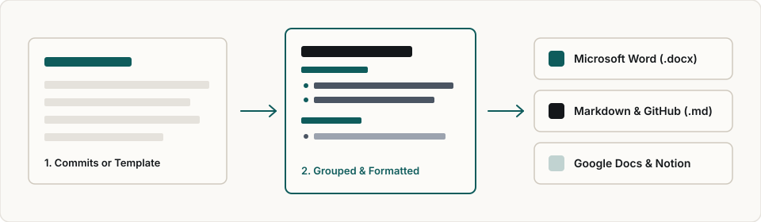
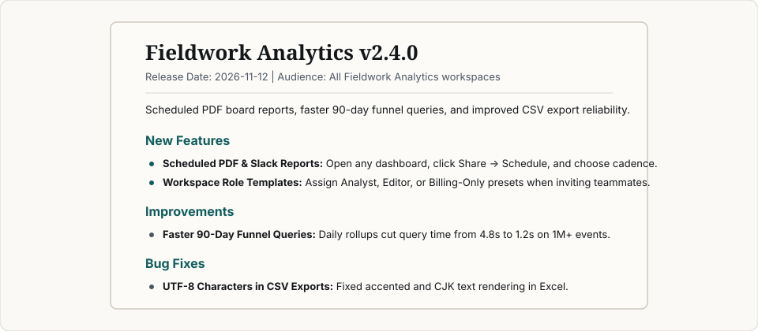
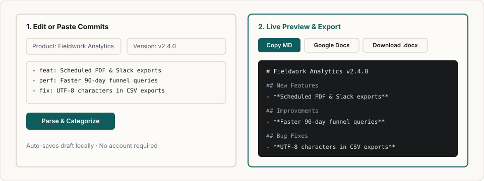
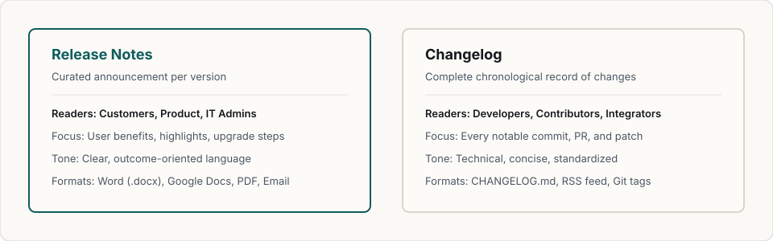

# Release notes templates and examples

Free release notes templates for software, SaaS products, mobile apps, and internal releases. Download Word (`.docx`) templates, copy Markdown examples, or generate release notes from your changes.

Live templates and free generator (no signup required): **https://changelog-software.github.io/Release-Notes/**



## What are release notes

Release notes are short updates published alongside a new software version. They explain what changed, who is affected, and whether an upgrade or migration step is required.

Good release notes translate engineering work into clear outcomes for customers, IT admins, or internal stakeholders.

## Release notes template library

Each template is available as a Markdown (`.md`) file, a formatted Microsoft Word (`.docx`) document compatible with Google Docs, and a filled-in example.

| Use Case | Blank Template (Markdown) | Blank Template (Word `.docx`) | Filled-In Example | Best For |
| --- | --- | --- | --- | --- |
| **SaaS Product** | [saas-release-notes.md](templates/saas-release-notes.md) | [saas-release-notes.docx](templates/saas-release-notes.docx) | [Fieldwork Analytics v2.4.0](examples/saas-release-notes-example.md) | Web apps, B2B SaaS dashboards |
| **Software (Standard)** | [software-release-notes.md](templates/software-release-notes.md) | [software-release-notes.docx](templates/software-release-notes.docx) | [SyncDesk v4.2.1](examples/software-release-notes-example.md) | Desktop apps, CLI tools, self-hosted software |
| **Mobile App (iOS & Android)** | [mobile-app-release-notes.md](templates/mobile-app-release-notes.md) | [mobile-app-release-notes.docx](templates/mobile-app-release-notes.docx) | [TrailPulse v3.1.2](examples/mobile-app-release-notes-example.md) | App Store & Google Play updates |
| **Internal / Engineering** | [internal-release-notes.md](templates/internal-release-notes.md) | [internal-release-notes.docx](templates/internal-release-notes.docx) | [Billing Core RC2](examples/internal-release-notes-example.md) | Sprint demos, QA, DevOps, feature flags |
| **Enterprise / B2B** | [enterprise-release-notes.md](templates/enterprise-release-notes.md) | [enterprise-release-notes.docx](templates/enterprise-release-notes.docx) | [VaultGrid v7.0.0](examples/enterprise-release-notes-example.md) | IT admins, SSO/SCIM, security & compliance |
| **API & SDK** | [api-release-notes.md](templates/api-release-notes.md) | [api-release-notes.docx](templates/api-release-notes.docx) | [PayFlow API v3.2.0](examples/api-release-notes-example.md) | REST/GraphQL APIs, breaking changes, SDKs |
| **Word (.docx)** | [release-notes-template-word.md](templates/release-notes-template-word.md) | [release-notes-template-word.docx](templates/release-notes-template-word.docx) | [LedgerFlow v5.3.0](examples/release-notes-template-word-example.md) | Formal Word & PDF sign-off |
| **Google Docs** | [google-docs-release-notes-template.md](templates/google-docs-release-notes-template.md) | [google-docs-release-notes-template.docx](templates/google-docs-release-notes-template.docx) | [ClearDesk v2.9.0](examples/google-docs-release-notes-template-example.md) | Collaborative Google Drive review |

## Using templates in Word, Google Docs, and Markdown

Download any `.docx` file from [`templates/`](templates/) for Microsoft Word, or generate a custom `.docx` in the browser. For Google Docs, click **Copy for Google Docs** on the [live site](https://changelog-software.github.io/Release-Notes/) to paste formatted headings and bullet lists directly, or upload a `.docx` file to Google Drive. For GitHub Releases and static docs, copy any `.md` file from [`templates/`](templates/).



## Sample release notes (SaaS example)

```markdown
# Fieldwork Analytics v2.4.0

**Release Date:** 2026-11-12 | **Audience:** All Fieldwork Analytics workspaces

Scheduled PDF board reports, faster 90-day funnel queries, and improved CSV export reliability.

## Highlights

- Schedule weekly or monthly PDF reports straight to Slack or email.
- Pre-aggregated daily rollups keep 90-day funnel queries under 1.2s on 1M+ events.

## New Features

- **Scheduled PDF & Slack Reports**: Open any dashboard, click Share -> Schedule, and choose a daily, weekly, or monthly delivery cadence.
- **Workspace Role Templates**: Admins can now assign Analyst, Editor, or Billing-Only presets when inviting teammates.

## Improvements

- **Faster 90-Day Funnel Queries**: Pre-aggregated daily rollups cut query time from 4.8s to 1.2s on multi-step funnels with more than 1M events.

## Bug Fixes

- **UTF-8 Characters in CSV Exports**: Fixed an issue where accented characters and CJK text displayed incorrectly when opening exported CSVs in Excel.
```

See all filled-in examples in [`examples/`](examples/) or on the [examples page](https://changelog-software.github.io/Release-Notes/examples/).

## Free release notes generator

Use the browser-based generator at **https://changelog-software.github.io/Release-Notes/#generator**.



Pick a template (SaaS, Software, Mobile, Internal, Enterprise, or API) or paste raw `git log` lines and PR titles (`feat:`, `fix:`, `perf:`, `security:`, `BREAKING CHANGE:`). Edit the version, date, summary, and grouped items, then export with no signup via Copy Markdown, Copy for Google Docs, Copy HTML, Download `.docx`, or Download `.md`.

## How to write clear release notes

1. Start with user impact by stating what someone can now do instead of which internal module changed.
2. Group changes under predictable headings (`New Features`, `Improvements`, `Bug Fixes`, `Breaking Changes`, `Security Updates`).
3. Spell out upgrade steps when users need to update, migrate, or toggle a setting.
4. Bold the feature name and keep the explanation to one concise sentence.

## Release notes vs. changelog



| Dimension | Release Notes | Changelog |
| --- | --- | --- |
| Primary audience | Customers, product teams, stakeholders | Developers, integrators, contributors |
| Scope | Curated highlights, benefits, and upgrade notes | Complete chronological record of changes |
| Tone | Outcome-oriented, plain language | Technical, concise, standardized |
| Common formats | Word (`.docx`), Google Docs, PDF, email, GitHub Release | `CHANGELOG.md`, RSS feed, public web timeline |

## Local development

```bash
npm install
npm run generate:assets   # Regenerate templates/*.md, templates/*.docx, examples/*
npm test                  # Run unit tests
npm run dev               # Start local dev server
npm run build             # Build app + static SEO pages + sitemap.xml into dist/
```

## License

MIT
